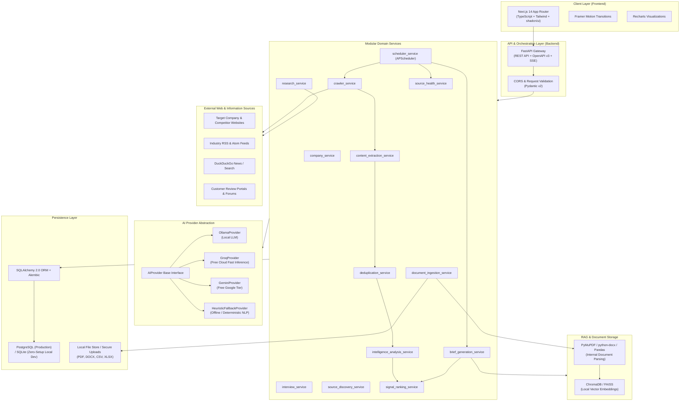
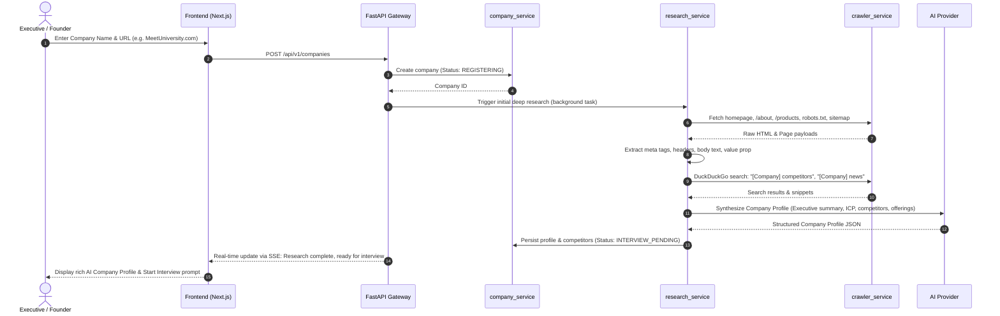
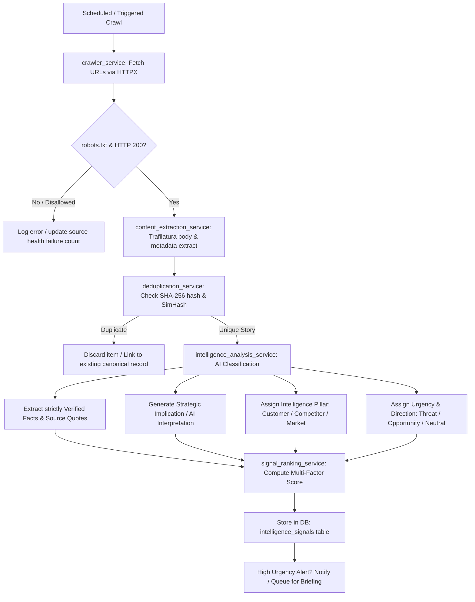
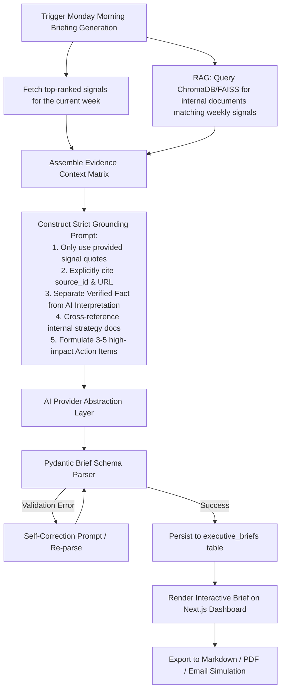

# Signal Stack — Architecture & Technical Specifications

**Product**: Signal Stack (Company Intelligence & Executive Briefing Engine)  
**Author**: Senior AI Engineer, Software Architect & Technical Product Manager  
**Version**: 1.0.0  
**Status**: Architecture Design Document  

---

## 1. Executive Summary & Core Engineering Philosophy

Signal Stack is an autonomous, evidence-backed intelligence engine designed for startup founders and executive leadership. Modern executives suffer from information overload: hundreds of RSS feeds, blogs, competitors' websites, newsletters, and press releases drown out actionable strategy. 

Signal Stack solves this by:
1. Researching any company from its domain name in under 60 seconds.
2. Conducting an adaptive 10-question AI interview that calibrates to the founder's strategic priorities.
3. Automatically generating an curated "Signal Stack" of customer, competitor, and market sources.
4. Continuously monitoring and crawling real sources with deduplication and verification.
5. Synthesizing developments into an actionable, evidence-linked **Monday Morning Intelligence Brief**.

### Non-Negotiable Engineering Principles

1. **Zero Hallucination / Traceable Evidence**: No intelligence item or signal is ever created without a verifiable quote, raw source URL, crawl timestamp, and publisher identity.
2. **Clear Fact vs. Interpretation Separation**: In all data models and UI views, "Verified Fact" (raw extracted observation) is strictly partitioned from "AI Interpretation" (strategic implication and why it matters) and "Recommended Executive Action".
3. **Genuine Free-Tier & Local-First AI**: The system defaults to local Ollama models (`llama3.2`, `mistral`, `qwen2.5`). It provides a pluggable AI provider abstraction supporting free-tier cloud APIs (Google Gemini, Groq) and includes a deterministic heuristic fallback engine. It **never** requires a paid OpenAI/Anthropic API key to function.
4. **Ethical & Resilient Crawling**: Full compliance with `robots.txt`, exponential backoff rate limiting, user-agent transparency, caching, and graceful failure handling.
5. **No Placeholders / Real Implementations**: Every button, API route, and database model connects end-to-end with real persistent data and backend logic.

---

## 2. High-Level System Architecture



---

## 3. Modular Backend Services Breakdown

The backend is structured into 13 high-cohesion, low-coupling services located under `backend/app/services/`:

| Service Name | Primary Responsibilities | Key Dependencies |
| :--- | :--- | :--- |
| `company_service` | Company registration, lifecycle states, metadata updates, workspace isolation. | SQLAlchemy, Pydantic |
| `research_service` | Initial domain crawl, homepage inspection, sitemap analysis, meta tag & schema.org extraction, web search for press & traction. | HTTPX, BeautifulSoup, Trafilatura, DuckDuckGo Search |
| `interview_service` | Adaptive 10-question interview engine. Dynamically generates question 1 based on company research, and questions 2–10 adaptively based on past answers. Synthesizes strategic priority vectors. | AI Provider Abstraction, SQLAlchemy |
| `source_discovery_service` | Algorithmic discovery of 15–30 intelligence sources across Competitor, Customer, and Market pillars tailored to the company profile. | DuckDuckGo, Feedparser, AI Provider |
| `crawler_service` | Async web crawler respecting robots.txt, rate limits, HTTP header policies, timeouts, and fallback rendering. | HTTPX (AsyncClient), urllib.robotparser, Playwright (conditional) |
| `content_extraction_service` | Main article extraction, date parsing, author detection, boilerplate removal, HTML-to-text cleanup. | Trafilatura, BeautifulSoup, lxml, dateparser |
| `deduplication_service` | Exact hash match (SHA-256) and near-duplicate detection (SimHash / MinHash / Cosine token overlap) to eliminate duplicate news stories. | hashlib, textdistance / SimHash |
| `intelligence_analysis_service` | Categorizes raw text into intelligence pillars (Customer, Competitor, Market), extracts strictly verified quotes, infers strategic implications. | AI Provider Abstraction |
| `signal_ranking_service` | Scores intelligence signals based on relevance, urgency, business impact, source reliability, and founder interview priorities. | NumPy / Math scoring engine |
| `brief_generation_service` | Synthesizes the Monday Morning Brief using top-ranked signals + RAG context from internal uploaded documents. Generates executive TL;DR, competitor movements, market shifts, customer voice, and action items. | AI Provider Abstraction, Vector DB |
| `document_ingestion_service` | Ingests internal strategy decks (PDF), spreadsheets (CSV/XLSX), roadmaps (DOCX), extracts text, chunks, and indexes into vector store. | PyMuPDF (fitz), python-docx, pandas, sentence-transformers / ChromaDB |
| `scheduler_service` | Manages cron jobs: weekly monitoring crawl & brief generation (every Monday at 06:00 AM) and monthly source health audits. | APScheduler (AsyncIOScheduler) |
| `source_health_service` | Performs monthly audits of all sources in the stack: HTTP status, content yield, noise ratio, response times, and suggests replacements for dead sources. | HTTPX, SQLAlchemy |

---

## 4. End-to-End Architectural Data Flows

### Flow 1: Company Registration & Automated Initial Research



### Flow 2: Adaptive 10-Question Founder Interview Engine

Unlike rigid static forms, Signal Stack uses an adaptive, conversational probe where every subsequent question directly references the founder's prior responses and research data.

```mermaid
sequenceDiagram
    autonumber
    actor Founder as Executive / Founder
    participant UI as Frontend (Next.js)
    participant API as FastAPI Gateway
    participant IntSvc as interview_service
    participant AISvc as AI Provider

    Founder->>UI: Click "Start Strategic Calibration"
    UI->>API: POST /api/v1/interviews/sessions {company_id}
    API->>IntSvc: Start session
    IntSvc->>AISvc: Generate Question 1 (Ground in company profile & identified competitors)
    AISvc-->>IntSvc: Question 1 + Category + Strategic Rationale
    IntSvc-->>API-->>UI: Question 1 displayed
    
    loop Questions 1 through 10
        Founder->>UI: Types or selects detailed response
        UI->>API: POST /api/v1/interviews/sessions/{id}/answer {question_number, answer}
        API->>IntSvc: Ingest answer, extract key priorities & sentiment
        IntSvc->>IntSvc: Store QA record
        alt Question Number < 10
            IntSvc->>AISvc: Prompt next question using: (Company Profile + All Prior Q&As + Uncovered Blindspots)
            AISvc-->>IntSvc: Adaptive Question (N+1)
            IntSvc-->>API-->>UI: Return Question (N+1)
        else Question Number == 10
            IntSvc->>AISvc: Synthesize "Executive Intelligence Vector" & Priority Weights
            AISvc-->>IntSvc: Priority Weights (e.g. competitor_pricing: 0.95, churn_risk: 0.85)
            IntSvc->>API: Mark session COMPLETED
            API-->>UI: Interview complete! Display strategic calibration summary
        end
    end
```

### Flow 3: Continuous Ingestion, Deduplication, Classification & Ranking



### Flow 4: Monday Morning Intelligence Brief Generation (with RAG)



---

## 5. Multi-Provider AI Abstraction Layer

To strictly uphold the requirement of **"Never require a paid API"**, Signal Stack implements a resilient provider interface:

```
                      ┌────────────────────────────────┐
                      │    AIProvider (ABC / Base)     │
                      │  - generate_text()             │
                      │  - generate_structured_json()  │
                      │  - generate_embeddings()       │
                      │  - check_health()              │
                      └───────────────▲────────────────┘
                                      │
         ┌──────────────────┬─────────┴────────┬──────────────────┐
         │                  │                  │                  │
┌────────┴────────┐ ┌───────┴────────┐ ┌───────┴────────┐ ┌───────┴────────┐
│ OllamaProvider  │ │ GroqProvider   │ │ GeminiProvider │ │ HeuristicEngine│
│ (Default/Local) │ │ (Free Cloud API│ │ (Free Cloud API│ │ (Zero-Key      │
│ localhost:11434 │ │ gsk_...        │ │ AIzaSy...      │ │ Deterministic) │
│ llama3.2 / mist │ │ llama-3.3-70b  │ │ gemini-1.5-flas│ │ NLP & Heuristic│
└─────────────────┘ └────────────────┘ └────────────────┘ └────────────────┘
```

### Priority & Fallback Chain
1. **Ollama (Local Default)**: If Ollama daemon is reachable on `http://localhost:11434`, it executes inferences locally with complete privacy.
2. **Groq (Free Cloud Tier)**: If `GROQ_API_KEY` is provided, lightning-fast inference with Llama 3.3 70B (free tier allows 30 requests/min).
3. **Google Gemini (Free Cloud Tier)**: If `GEMINI_API_KEY` is provided, Gemini 1.5 Flash (free tier allows 15 RPM).
4. **Deterministic Heuristic Fallback Engine**: If no LLM daemon or API key is available, the built-in heuristic engine activates. It uses rule-based extraction, text summarization, regex patterns, and curated question trees so the application never breaks or stalls in testing environments.

---

## 6. Frontend Page Structure & Navigation

The frontend is an executive-grade dashboard built with Next.js 14 App Router, Tailwind CSS, shadcn/ui, Framer Motion, and Recharts:

```
frontend/src/app/
├── layout.tsx                     # Root executive dark-theme shell with top nav
├── page.tsx                       # Landing / Company Switcher / Welcome view
├── companies/
│   ├── new/page.tsx               # Company Onboarding (Enter Name & URL)
│   └── [companyId]/
│       ├── layout.tsx             # Company dashboard layout with sidebar
│       ├── overview/page.tsx      # Executive Overview & Vital Stats
│       ├── interview/page.tsx     # Adaptive 10-Question Founder Interview
│       ├── stack/page.tsx         # Signal Stack Manager (Discovered & Approved Sources)
│       ├── signals/page.tsx       # Live Intelligence Signal Feed (Filtering & Evidence Modal)
│       ├── briefs/
│       │   ├── page.tsx           # Briefings Archive & Trend Charts
│       │   └── [briefId]/page.tsx # Full Monday Morning Intelligence Brief (Interactive)
│       ├── documents/page.tsx     # Internal Intelligence Ingestion (Upload PDF/DOCX/CSV)
│       ├── health/page.tsx        # Monthly Source Health Audit Matrix
│       └── settings/page.tsx      # AI Provider Selector & Crawl Configurations
```

---

## 7. Security, Rate Limiting & Ethical Crawling Policy

1. **Robots.txt Adherence**: The crawler initializes `urllib.robotparser.RobotFileParser` for each domain. If a target URL is disallowed, crawling halts immediately and records `robots_disallowed`.
2. **Polite Request Delays**: Minimum delay between requests to the same host is 1.5 seconds.
3. **Identification**: User-agent header: `SignalStackBot/1.0 (+https://signalstack.internal; research-bot@signalstack.internal)`.
4. **Zero Frontend Secrets**: API keys (Groq, Gemini) are stored strictly on the server in `.env` or encrypted database settings. Never sent to the client.
5. **Sandboxed Document Parsing**: Uploaded files (PDF, DOCX, XLSX) are inspected for MIME types, size limits (max 25MB), and parsed in memory without shell execution.

---

## 8. Primary Demo Companies for Verification

Signal Stack is built to support dynamic configurations for any business. The three target verification companies are:

1. **MeetUniversity (`https://www.meetuniversity.com`) [PRIMARY DEMO]**:
   - **Industry**: EdTech / Study Abroad Marketplace & Higher-Ed Recruitment.
   - **Key Competitors to Track**: LeapScholar, Leverage Edu, IDP Education, Yocket, CollegeDekho.
   - **Target Intelligence**: International visa policy changes (UK/Canada/US), university commission rates, student sentiment, competitor scholarship offers.
2. **Postman (`https://www.postman.com`)**:
   - **Industry**: Developer Tools / API Management & Collaboration Platform.
   - **Key Competitors**: Insomnia, Bruno, Hoppscotch, SwaggerHub, Thunder Client.
   - **Target Intelligence**: Pricing changes for team tiers, protocol support (gRPC/GraphQL/Kafka), developer community sentiment, open-source alternatives.
3. **Linear (`https://linear.app`)**:
   - **Industry**: B2B SaaS / Project Management & Issue Tracking for High-Performance Teams.
   - **Key Competitors**: Jira (Atlassian), Height.app, Plane.so, GitHub Projects, ClickUp.
   - **Target Intelligence**: AI project management features, enterprise security certifications, pricing tier transitions, remote-work developer trends.
