# Signal Stack — Database Schema Specification

**System**: Signal Stack Persistence Layer  
**Engine**: SQLAlchemy 2.0 ORM  
**Supported Dialects**: SQLite 3 (Default Local / Zero-Setup) & PostgreSQL 15+ (Production)  
**Status**: Specification Complete  

---

## 1. Database Architectural Strategy

Signal Stack is architected to run seamlessly in two modes without changing business logic:
1. **Local Development Mode**: SQLite (`sqlite+aiosqlite:///./data/signal_stack.db`). Zero external dependencies; developers or testers can clone and run with no local Docker or Postgres setup required.
2. **Production Deployment Mode**: PostgreSQL (`postgresql+asyncpg://...`). High concurrency, JSONB indexing, and connection pooling.

To maintain 100% portability, all JSON structures are stored using SQLAlchemy's universal `JSON` type (which maps to `JSONB` in Postgres and `TEXT` with JSON serialization in SQLite). Foreign keys and timestamps are indexed consistently across both dialects.

---

## 2. Entity-Relationship Diagram (ERD)

```mermaid
erDiagram
    COMPANIES ||--|| COMPANY_PROFILES : has
    COMPANIES ||--o{ INTERVIEW_SESSIONS : conducts
    INTERVIEW_SESSIONS ||--o{ INTERVIEW_QA : contains
    COMPANIES ||--o{ COMPETITORS : monitors
    COMPANIES ||--o{ INTELLIGENCE_SOURCES : maintains
    INTELLIGENCE_SOURCES ||--o{ CRAWLED_ITEMS : yields
    CRAWLED_ITEMS ||--o{ INTELLIGENCE_SIGNALS : produces
    COMPANIES ||--o{ INTELLIGENCE_SIGNALS : owns
    COMPANIES ||--o{ INTERNAL_DOCUMENTS : ingests
    INTERNAL_DOCUMENTS ||--o{ DOCUMENT_CHUNKS : splits_into
    COMPANIES ||--o{ EXECUTIVE_BRIEFS : receives
    COMPANIES ||--o{ SOURCE_HEALTH_AUDITS : undergoes
    SOURCE_HEALTH_AUDITS ||--o{ AUDIT_SOURCE_RECORDS : details
    COMPANIES ||--o{ SCHEDULED_JOBS : configures

    COMPANIES {
        string id PK "UUID"
        string name "Company Name"
        string website_url "Primary URL"
        string industry "Industry / Category"
        string geography "Target Geography"
        string onboarding_status "REGISTERED | RESEARCHED | INTERVIEWED | ACTIVE"
        datetime created_at
        datetime updated_at
    }

    COMPANY_PROFILES {
        string id PK "UUID"
        string company_id FK "References COMPANIES.id"
        text executive_summary "AI Synthesized Overview"
        text value_proposition "Core Value Prop"
        text target_customer_profile "ICP Description"
        string business_model "B2B | B2C | Marketplace"
        json raw_research_data "Extracted Web Content"
        datetime created_at
        datetime updated_at
    }

    INTERVIEW_SESSIONS {
        string id PK "UUID"
        string company_id FK "References COMPANIES.id"
        string status "IN_PROGRESS | COMPLETED | ABANDONED"
        int current_question_number "1 through 10"
        json executive_priority_weights "Synthesized strategic weights"
        datetime started_at
        datetime completed_at
    }

    INTERVIEW_QA {
        string id PK "UUID"
        string session_id FK "References INTERVIEW_SESSIONS.id"
        int question_number "1 through 10"
        text question_text "Adaptive Question"
        string question_category "Moat | Pricing | Competitors | etc."
        text rationale "Why this question was asked"
        text founder_answer "Founder's Response"
        json extracted_insights "Parsed strategic constraints"
        datetime answered_at
    }

    COMPETITORS {
        string id PK "UUID"
        string company_id FK "References COMPANIES.id"
        string name "Competitor Name"
        string website_url "Competitor URL"
        string tier "DIRECT | INDIRECT | ASPIRATIONAL"
        text strategic_notes "Observed Threat Vector"
        boolean is_active "Monitoring Flag"
        datetime created_at
    }

    INTELLIGENCE_SOURCES {
        string id PK "UUID"
        string company_id FK "References COMPANIES.id"
        string name "Source Title"
        string url "Feed / Scrape URL"
        string source_type "RSS | WEBPAGE | NEWS_SEARCH | TWITTER_FEED"
        string pillar "CUSTOMER | COMPETITOR | MARKET"
        string approval_status "DISCOVERED | APPROVED | REJECTED | CUSTOM"
        string health_status "HEALTHY | WARNING | BROKEN | STALE"
        float reliability_score "0.0 to 1.0"
        int consecutive_failures "Error count"
        datetime last_crawled_at
        datetime created_at
    }

    CRAWLED_ITEMS {
        string id PK "UUID"
        string source_id FK "References INTELLIGENCE_SOURCES.id"
        string company_id FK "References COMPANIES.id"
        string url "Item URL"
        string title "Headline / Title"
        text raw_html "Compressed Raw HTML"
        text clean_text "Extracted Body"
        string author "Author / Reporter"
        string content_hash UK "SHA-256 of text"
        string simhash "Locality Sensitive Hash"
        datetime published_at
        datetime crawled_at
    }

    INTELLIGENCE_SIGNALS {
        string id PK "UUID"
        string company_id FK "References COMPANIES.id"
        string crawled_item_id FK "References CRAWLED_ITEMS.id"
        string title "Concise Signal Title"
        text verified_fact "Extract / Quote strictly from source"
        text ai_interpretation "Strategic implication & why it matters"
        text recommended_action "Prescribed executive action"
        string pillar "CUSTOMER | COMPETITOR | MARKET"
        string urgency "LOW | MEDIUM | HIGH | CRITICAL"
        string direction "OPPORTUNITY | THREAT | NEUTRAL"
        float confidence_score "0.0 to 1.0"
        float ranking_score "Combined multi-factor score"
        boolean is_archived "Archive flag"
        datetime created_at
    }

    INTERNAL_DOCUMENTS {
        string id PK "UUID"
        string company_id FK "References COMPANIES.id"
        string filename "Original filename"
        string file_type "PDF | DOCX | CSV | XLSX | TXT"
        string file_path "Stored filesystem path"
        int file_size_bytes "File size"
        int chunk_count "Number of indexed chunks"
        string status "INDEXED | PROCESSING | FAILED"
        datetime uploaded_at
    }

    DOCUMENT_CHUNKS {
        string id PK "UUID"
        string document_id FK "References INTERNAL_DOCUMENTS.id"
        int chunk_index "Index position"
        text chunk_text "Segment text"
        string vector_id "ChromaDB / FAISS Vector ID"
        datetime created_at
    }

    EXECUTIVE_BRIEFS {
        string id PK "UUID"
        string company_id FK "References COMPANIES.id"
        string brief_week "e.g. 2026-W46"
        string title "Monday Morning Intelligence Brief"
        text executive_tldr "Top 3 high-impact bullets"
        text strategic_alert "Highest urgency signal analysis"
        json competitor_movements "Competitor shifts with source citations"
        json market_shifts "Market trends & regulatory shifts"
        json customer_voice "Sentiment & customer reviews"
        json internal_alignment "RAG cross-referencing with uploaded docs"
        json action_items "3-5 tactical decisions for the week"
        json cited_signal_ids "List of referenced signal UUIDs"
        datetime generated_at
    }

    SOURCE_HEALTH_AUDITS {
        string id PK "UUID"
        string company_id FK "References COMPANIES.id"
        datetime audit_date
        int total_sources
        int healthy_count
        int warning_count
        int broken_count
        json summary_metrics
    }

    AUDIT_SOURCE_RECORDS {
        string id PK "UUID"
        string audit_id FK "References SOURCE_HEALTH_AUDITS.id"
        string source_id FK "References INTELLIGENCE_SOURCES.id"
        int http_status_code
        float response_time_ms
        int signals_produced_last_30d
        float duplicate_ratio
        string status_result "HEALTHY | WARNING | BROKEN"
        text recommendations "e.g. Update RSS URL or deprecate"
    }

    SCHEDULED_JOBS {
        string id PK "UUID"
        string company_id FK "References COMPANIES.id"
        string job_name "WEEKLY_BRIEF | MONTHLY_HEALTH_AUDIT | DAILY_CRAWL"
        string cron_expression "e.g. 0 6 * * 1"
        boolean is_active "Active flag"
        datetime last_run_at
        datetime next_run_at
        string last_status "SUCCESS | FAILED"
    }
```

---

## 3. Detailed Data Table Specifications

### 3.1. `companies`
Stores top-level enterprise workspaces and basic metadata.

| Column | Type | Constraints | Description |
| :--- | :--- | :--- | :--- |
| `id` | `VARCHAR(36)` | PRIMARY KEY | UUID v4 string |
| `name` | `VARCHAR(255)` | NOT NULL | Registered company name |
| `website_url` | `VARCHAR(512)` | NOT NULL | Canonical website URL |
| `industry` | `VARCHAR(100)` | NULLABLE | Industry sector (e.g. "EdTech", "DevTools") |
| `geography` | `VARCHAR(100)` | NULLABLE | Geographic primary market (e.g. "Global", "India/US") |
| `onboarding_status` | `VARCHAR(50)` | NOT NULL, DEFAULT 'REGISTERED' | Status enum: `REGISTERED`, `RESEARCHED`, `INTERVIEW_IN_PROGRESS`, `ACTIVE` |
| `created_at` | `DATETIME` | NOT NULL | Timestamp of registration |
| `updated_at` | `DATETIME` | NOT NULL | Last update timestamp |

### 3.2. `company_profiles`
Rich AI-synthesized profile populated from automated crawling and research.

| Column | Type | Constraints | Description |
| :--- | :--- | :--- | :--- |
| `id` | `VARCHAR(36)` | PRIMARY KEY | UUID v4 string |
| `company_id` | `VARCHAR(36)` | NOT NULL, FK(`companies.id`, CASCADE) | Parent company reference |
| `executive_summary` | `TEXT` | NOT NULL | 2-3 paragraph synthesis of business |
| `value_proposition` | `TEXT` | NOT NULL | Primary differentiation and core pitch |
| `target_customer_profile`| `TEXT` | NOT NULL | Detailed ICP breakdown |
| `business_model` | `VARCHAR(100)` | NOT NULL | B2B SaaS, B2C, Marketplace, EduTech, etc. |
| `core_strengths` | `JSON` | NOT NULL, DEFAULT '[]' | List of identified competitive advantages |
| `known_weaknesses` | `JSON` | NOT NULL, DEFAULT '[]' | List of market vulnerabilities or gaps |
| `raw_research_data` | `JSON` | NOT NULL, DEFAULT '{}' | Metadata, robots.txt status, meta tags, sitemap info |
| `created_at` | `DATETIME` | NOT NULL | Timestamp created |
| `updated_at` | `DATETIME` | NOT NULL | Timestamp updated |

### 3.3. `interview_sessions` & `interview_qa`
Manages the adaptive 10-question strategic calibration interview.

**`interview_sessions`**:
- `id` (PK, UUID)
- `company_id` (FK `companies.id`, CASCADE)
- `status` (`IN_PROGRESS`, `COMPLETED`, `ABANDONED`)
- `current_question_number` (INT, 1 to 10)
- `executive_priority_weights` (JSON: weighted map of strategic topics, e.g. `{"pricing_pressure": 0.9, "us_expansion": 0.85}`)
- `started_at` (DATETIME)
- `completed_at` (DATETIME, NULLABLE)

**`interview_qa`**:
- `id` (PK, UUID)
- `session_id` (FK `interview_sessions.id`, CASCADE)
- `question_number` (INT, 1 to 10, Indexed)
- `question_text` (TEXT, dynamically generated question)
- `question_category` (VARCHAR(100), e.g. "Competitive Moat", "Pricing Power", "Regulatory Risks")
- `rationale` (TEXT, AI reasoning for asking this specific question)
- `founder_answer` (TEXT, founder's raw answer)
- `extracted_insights` (JSON, parsed priorities, mentioned competitors, sensitive concerns)
- `answered_at` (DATETIME)

### 3.4. `competitors`
Monitored rivals and benchmark companies.

- `id` (PK, UUID)
- `company_id` (FK `companies.id`, CASCADE)
- `name` (VARCHAR(255), NOT NULL)
- `website_url` (VARCHAR(512), NOT NULL)
- `tier` (`DIRECT`, `INDIRECT`, `ASPIRATIONAL`, `EMERGING`)
- `strategic_notes` (TEXT, why this competitor matters)
- `is_active` (BOOLEAN, DEFAULT TRUE)
- `created_at` (DATETIME)

### 3.5. `intelligence_sources`
The curated "Signal Stack" of feeds, sites, and queries.

- `id` (PK, UUID)
- `company_id` (FK `companies.id`, CASCADE)
- `name` (VARCHAR(255), NOT NULL)
- `url` (VARCHAR(1024), NOT NULL)
- `source_type` (`RSS`, `WEBPAGE`, `NEWS_SEARCH`, `COMMUNITY`)
- `pillar` (`CUSTOMER`, `COMPETITOR`, `MARKET`)
- `expected_frequency` (`HOURLY`, `DAILY`, `WEEKLY`)
- `reliability_score` (FLOAT, 0.0 to 1.0, DEFAULT 0.8)
- `approval_status` (`DISCOVERED`, `APPROVED`, `REJECTED`, `CUSTOM`)
- `health_status` (`HEALTHY`, `WARNING`, `BROKEN`, `STALE`)
- `consecutive_failures` (INT, DEFAULT 0)
- `last_crawled_at` (DATETIME, NULLABLE)
- `last_success_at` (DATETIME, NULLABLE)
- `created_at` (DATETIME)

### 3.6. `crawled_items`
Raw ingested records from feeds and web pages.

- `id` (PK, UUID)
- `source_id` (FK `intelligence_sources.id`, CASCADE)
- `company_id` (FK `companies.id`, CASCADE)
- `url` (VARCHAR(1024), NOT NULL)
- `canonical_url` (VARCHAR(1024), NULLABLE)
- `title` (VARCHAR(512), NOT NULL)
- `raw_html` (TEXT, NULLABLE)
- `clean_text` (TEXT, NOT NULL)
- `author` (VARCHAR(255), NULLABLE)
- `content_hash` (VARCHAR(64), UNIQUE, INDEXED) -> SHA-256 for exact deduplication
- `simhash` (VARCHAR(64), INDEXED) -> 64-bit SimHash for near-duplicate detection
- `published_at` (DATETIME, NULLABLE)
- `crawled_at` (DATETIME, DEFAULT CURRENT_TIMESTAMP)

### 3.7. `intelligence_signals`
Classified, scored, and evidence-verified atomic intelligence units.

- `id` (PK, UUID)
- `company_id` (FK `companies.id`, CASCADE, INDEXED)
- `crawled_item_id` (FK `crawled_items.id`, CASCADE)
- `title` (VARCHAR(512), NOT NULL)
- `verified_fact` (TEXT, NOT NULL) -> **STRICT**: Exact extracted quote or fact from source
- `ai_interpretation` (TEXT, NOT NULL) -> **STRICT**: Strategic implication, separated from fact
- `recommended_action` (TEXT, NOT NULL) -> Concrete step for executive leadership
- `pillar` (`CUSTOMER`, `COMPETITOR`, `MARKET`, INDEXED)
- `urgency` (`LOW`, `MEDIUM`, `HIGH`, `CRITICAL`, INDEXED)
- `direction` (`OPPORTUNITY`, `THREAT`, `NEUTRAL`)
- `confidence_score` (FLOAT, 0.0 to 1.0)
- `ranking_score` (FLOAT, 0.0 to 100.0, INDEXED)
- `is_archived` (BOOLEAN, DEFAULT FALSE)
- `created_at` (DATETIME, INDEXED)

### 3.8. `internal_documents` & `document_chunks`
Internal company assets (strategy decks, OKRs, customer interviews).

**`internal_documents`**:
- `id` (PK, UUID)
- `company_id` (FK `companies.id`, CASCADE)
- `filename` (VARCHAR(255), NOT NULL)
- `file_type` (`PDF`, `DOCX`, `CSV`, `XLSX`, `TXT`)
- `file_path` (VARCHAR(1024), NOT NULL)
- `file_size_bytes` (INT)
- `chunk_count` (INT, DEFAULT 0)
- `status` (`PROCESSING`, `INDEXED`, `FAILED`)
- `uploaded_at` (DATETIME)

**`document_chunks`**:
- `id` (PK, UUID)
- `document_id` (FK `internal_documents.id`, CASCADE)
- `chunk_index` (INT, NOT NULL)
- `chunk_text` (TEXT, NOT NULL)
- `vector_id` (VARCHAR(128), NOT NULL, INDEXED)
- `created_at` (DATETIME)

### 3.9. `executive_briefs`
The synthesized weekly intelligence brief.

- `id` (PK, UUID)
- `company_id` (FK `companies.id`, CASCADE, INDEXED)
- `brief_week` (VARCHAR(10), NOT NULL, INDEXED) -> e.g. "2026-W46"
- `title` (VARCHAR(255), NOT NULL)
- `executive_tldr` (TEXT, NOT NULL) -> Top 3 strategic bullets
- `strategic_alert` (TEXT, NOT NULL) -> Urgent opportunity or threat
- `competitor_movements` (JSON, NOT NULL) -> Structured competitor updates with source quotes
- `market_shifts` (JSON, NOT NULL) -> Industry & regulatory trends with source quotes
- `customer_voice` (JSON, NOT NULL) -> Customer feedback, reviews, churn signals
- `internal_alignment` (JSON, NOT NULL) -> RAG cross-references with internal docs
- `action_items` (JSON, NOT NULL) -> 3-5 prioritized executive decisions
- `cited_signal_ids` (JSON, NOT NULL) -> Array of referenced signal UUIDs
- `status` (`DRAFT`, `PUBLISHED`, `ARCHIVED`)
- `generated_at` (DATETIME, DEFAULT CURRENT_TIMESTAMP)

### 3.10. `source_health_audits` & `audit_source_records`
Monthly audit history and per-source performance metrics.

- Tracks source uptime, response latency, noise-to-signal ratio, and dead links.

### 3.11. `scheduled_jobs`
APScheduler status records ensuring transparency of automated jobs.

---

## 4. Indexing & Optimization Strategy

1. **Deduplication Lookup**:
   - `CREATE UNIQUE INDEX idx_crawled_items_hash ON crawled_items(content_hash);`
   - `CREATE INDEX idx_crawled_items_url ON crawled_items(url);`
2. **Weekly Brief Generation Speed**:
   - `CREATE INDEX idx_signals_company_created_rank ON intelligence_signals(company_id, created_at DESC, ranking_score DESC);`
   - Allows sub-10ms retrieval of top 20 signals for the week.
3. **Pillar & Urgency Filtering**:
   - `CREATE INDEX idx_signals_pillar_urgency ON intelligence_signals(company_id, pillar, urgency);`
4. **Source Health Queries**:
   - `CREATE INDEX idx_sources_health ON intelligence_sources(company_id, health_status, approval_status);`
